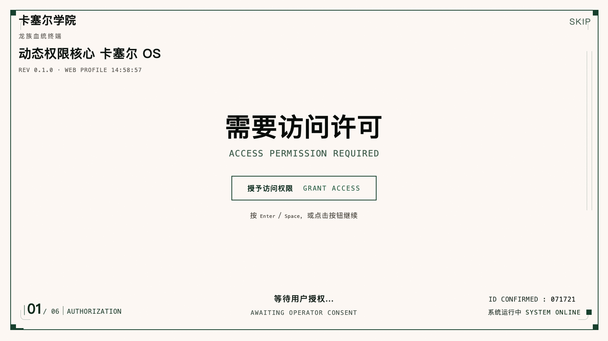

# dsh-kassel-boot

卡塞尔学院风格的 **DeepSeek Harness 启动动画**。DSH 启动（页面加载）时，在 `shell.overlay`
框架级浮层上铺一块全屏画面，播放六屏授权序列，结尾以暗金「欢迎来到卡塞尔」交还宿主。



| # | 代号 | 内容 |
|---|---|---|
| 01 | AUTHORIZATION | 等待用户授权 |
| 02 | IDENTITY | 核对身份资料（RICARDO M. LU / A.D.0013 / S 级） |
| 03 | REQUEST | 请求终端权限 |
| 04 | READ | 读取血统档案 |
| 05 | VERIFY | 核验通过 → 即将接入卡塞尔学院 |
| 06 | WELCOME | WELCOME TO KASSEL ·【接入终端】 |

每一屏都要**点一下**（或按 `Enter` / `空格`）才进下一屏，不自动播放。右上角 `SKIP` 直接跳到第 06 屏。
点「接入终端」→ 金色大字逐字浮现 → 自动淡出 → 插件自行卸载，把界面交还给 DSH。

---

## 安装

安装方式与 [`dsh-startup-screen`](https://github.com/6shenhonghong9/dsh-startup-screen) 一致：
下载 tgz，用 DSH 自带的 `dsh plugin add` 装进去。

### 一、直接安装（推荐）

先下载安装包：

```bash
curl -fL -o dsh-kassel-boot-0.1.1.tgz \
  https://github.com/Ffwjl010831/dsh-plugin-kassel-boot/releases/download/v0.1.1/dsh-kassel-boot-0.1.1.tgz
```

再装进桌面端 profile：

```bash
dsh plugin --profile desktop add ./dsh-kassel-boot-0.1.1.tgz
```

`web` profile 同理，把 `desktop` 换成 `web`。装完 **⌘Q 完全退出 DeepSeek Harness**，再打开就能看到动画。

> **两个前提**
>
> 1. `dsh` 命令要在 PATH 里 —— DSH 菜单里有「安装命令行工具」。没装就用完整路径：
>    `/Applications/DeepSeek\ Harness.app/Contents/Resources/runtime/cli/bin/dsh`
> 2. **先打开一次 DSH 让 profile 初始化，再 ⌘Q 完全退出**，然后执行命令。否则会报
>    `Open DeepSeek Harness Desktop once to initialize its profile`。

### 为什么必须用 `dsh plugin add`

DSH 靠 **`dsh.profile.bundles`** 这个层堆栈决定加载哪些插件。`dsh plugin add` 是 `pnpm add` 的包装，
装完之后 DSH 会**自动把「声明了 `dsh.bundle` 的依赖」并入层堆栈** —— 本插件在 `package.json` 里
声明的 `dsh.bundle.patch` 指向 `cordis.patch.yml`，就在那一步作为一层被应用。

手工把目录拷进 `node_modules` 不会被识别，少的就是这一步。

### 二、一行命令 / 双击（本仓库额外提供）

不想手动下载的话：

```bash
curl -fsSL https://cdn.jsdelivr.net/gh/Ffwjl010831/dsh-plugin-kassel-boot@v0.1.1/install.sh | bash
```

或下载 [install.command](https://cdn.jsdelivr.net/gh/Ffwjl010831/dsh-plugin-kassel-boot@v0.1.1/install.command)
后右键 →「打开」→ 再点一次「打开」。这两条走脚本内部的等价流程（放文件 + 写 `bundles`），
不需要 `dsh` 命令，适合命令行工具没装的情况。

### 三、桌面端「插件」页

部分 DSH 版本会拒绝在终端里操作 `desktop` profile（提示 managed exclusively by the Electron
application）。这时打开 DSH 的「插件」页，按 **tarball / 本地路径** 来源添加上面那个 tgz。

> **别用 `dsh plugin add github:用户名/仓库`。** pnpm 会通过 HTTPS 拉 git 仓库，部分网络下直接
> `CONNECT tunnel failed, response 502`；即便网络通，git 来源还会触发 `prepare` 构建被 pnpm 拦截，
> 要额外配 `allowBuilds`。走 tgz 最稳。

### 手动装（不用 pnpm）

把仓库内容放到 `~/.dsh/plugins/dsh-kassel-boot`（注意目录名是 `dsh-kassel-boot`，克隆下来的仓库
目录叫 `dsh-plugin-kassel-boot`，改名或只复制内容），然后：

```bash
ln -sfn ../../plugins/dsh-kassel-boot ~/.dsh/profiles/desktop/node_modules/dsh-kassel-boot
```

并在 `~/.dsh/profiles/desktop/package.json` 里加两处：

```jsonc
{
  "dependencies": { "dsh-kassel-boot": "link:../../plugins/dsh-kassel-boot" },
  "dsh": { "profile": { "bundles": ["...", "dsh-kassel-boot"] } }
}
```

### 网络说明

国内直连 `raw.githubusercontent.com` 经常超时，上面统一用 jsDelivr 镜像。
`install.sh` 内部也是**多源回落**：jsDelivr → raw → ghfast，前一个不通自动换下一个。

---

## 卸载

用 `dsh plugin add` 装的：

```bash
dsh plugin --profile desktop remove dsh-kassel-boot
```

用一行命令 / 双击装的（脚本会把两处都清干净）：

```bash
curl -fsSL https://cdn.jsdelivr.net/gh/Ffwjl010831/dsh-plugin-kassel-boot@v0.1.1/install.sh | bash -s -- --uninstall
```

或者本地跑 `sh install.sh --uninstall`。卸载后同样要 ⌘Q 重启。

---

## 结构

```
dsh-plugin-kassel-boot/
├── package.json          # dsh.bundle.patch + dsh.client 声明
├── cordis.patch.yml      # 把插件行插入 Cordis 配置树
├── lib/
│   ├── index.js          # 宿主半（Node）：空实现，能力全在浏览器半
│   ├── client.js         # 浏览器半：往 shell.overlay 注册全屏组件
│   └── boot.html         # 六屏动画本体（被 base64 内联进 client.js）
├── assets/
│   ├── icon.png          # 插件图标（校徽）
│   └── preview.png       # 启动画面预览
├── install.sh            # 安装 / 卸载脚本（唯一真源）
├── install.command       # 自解压单文件（install.sh + 内嵌 tgz），双击即装
├── build.js              # 把 boot.html 内联进 client.js
├── build-share.js        # 把 install.sh + tgz 合并成 install.command
└── build-share.sh        # 一键重新打包
```

浏览器半把 `boot.html` 以 base64 内联，运行时解码塞进 `iframe.srcdoc` —— 样式与 DSH 完全隔离，
也不依赖宿主静态路由或文件协议。动画与宿主只靠一条消息通信：

```js
// iframe 内（金色弹窗播完）
window.parent.postMessage({ type: 'kassel-boot-go' }, '*')

// 宿主组件收到后淡出并卸载
```

---

## 改动画内容

改 `lib/boot.html`，重新内联：

```bash
node build.js
```

## 重新打包发布

```bash
node build.js && ./build-share.sh
```

产出 `dist/卡塞尔启动动画/`、`卡塞尔启动动画-分享包.zip`、`install.command`。
然后 `git add -A && git commit -m "..." && git push`，再打新 tag：

```bash
git tag v0.1.1 && git push origin v0.1.1
```

## License

[MIT](LICENSE)
